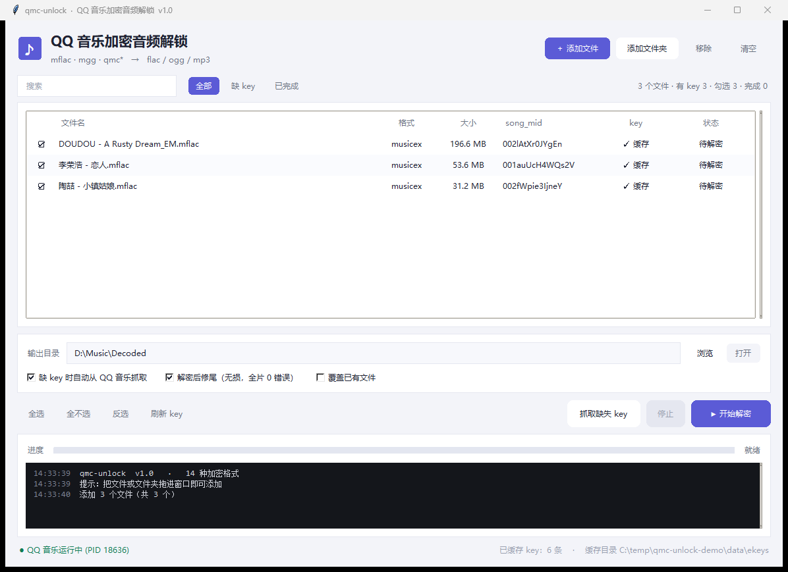

# qmc-unlock

> 把 QQ 音乐下载的加密音频（`.mflac` / `.mgg` / `.qmc*`）还原成通用格式 `.flac` / `.ogg` / `.mp3`。
> **本地解密、不联网、不要 cookie、不调用任何服务端接口。**



## 特性

- **支持 14 种后缀**：`mflac` `mflac0` `mgg` `mgg0` `mgg1` `mggl` `qmcflac` `qmcogg` `qmc0` `qmc2` `qmc3` `bkcmp3` `bkcflac` `tkm`
- **三种尾部布局自动识别**：`musicex v1` / `QTag` / `STag` / `QMCv2 raw-key-tail`
- **key 只取一次，之后永久离线**：从本机 QQ 音乐客户端的解密函数里读一次 QMC 流 key，写进本地缓存
- **图形界面 + 命令行**：拖拽、勾选、搜索筛选、批量、进度、彩色日志、右键菜单
- **C 加速**：QMC2 解密编译成本地库，比纯 Python 快约 40 倍（无 gcc 时自动回退）
- **可选修尾**：解密后 FFmpeg 无损重封装，去掉尾部加密填充，全片 0 错误
- **绿色便携**：整个文件夹拷走即用，不写注册表、不写 `%APPDATA%`

## 下载

| 产物 | 位置 |
|---|---|
| **便携版（推荐）** | [Releases](https://github.com/DECADE0502/qmc-unlock/releases/latest) → `qmc-unlock-portable-*.zip` |
| 源码 | `git clone https://github.com/DECADE0502/qmc-unlock.git` |
| 单文件版 | 自行构建：`tools\build_exe.bat` |

## 快速开始

### 方式一：便携版（推荐，免安装）

1. 解压发布包里的 `qmc-unlock-portable.zip`
2. 双击 `qmc-unlock-portable\qmc-unlock-portable.exe`
3. 把文件/文件夹**拖进窗口** → 勾选 → 点「开始解密」

整个 `qmc-unlock-portable` 文件夹要放在一起（`_internal\` 是运行时）。

### 方式二：源码运行

```bash
pip install frida tkinterdnd2      # frida 用于抓 key，tkinterdnd2 用于拖拽
python qmc-unlock-gui.py           # 图形界面
```

命令行：

```bash
python qmc_unlock.py info    "D:\Music\VipSongsDownload"          # 看格式 / key 状态
python qmc_unlock.py grabkeys "D:\Music\VipSongsDownload"         # 抓 key 并缓存
python qmc_unlock.py decrypt "D:\Music\VipSongsDownload" -o out --trim
```

一步到位（缺 key 时自动去客户端抓）：

```bash
python qmc_unlock.py decrypt "D:\Music\VipSongsDownload" -o out --from-client --trim
```

### 方式三：自己构建 exe

```bat
pip install pyinstaller tkinterdnd2 frida

rem 便携目录版（推荐，不写临时目录）
pyinstaller --noconfirm --clean --onedir --windowed ^
  --name qmc-unlock-portable --icon assets\app.ico ^
  --add-binary "qmc2_fast.dll;." ^
  --collect-all tkinterdnd2 --collect-all frida qmc-unlock-gui.py

rem 单文件版
pyinstaller --noconfirm --clean --onefile --windowed ^
  --name qmc-unlock --icon assets\app.ico ^
  --add-binary "qmc2_fast.dll;." ^
  --collect-all tkinterdnd2 --collect-all frida qmc-unlock-gui.py
```

`qmc2_fast.dll` 首次运行时自动生成在缓存目录，想随包分发就从那里拷出来。

## 图形界面

| 区域 | 能力 |
|---|---|
| 文件列表 | 文件名 / 格式 / 大小 / `song_mid` / key 状态 / 状态，点表头排序 |
| 筛选 | 搜索框（文件名 + song_mid）、`全部 / 缺 key / 已完成` |
| 勾选 | 点第一列 ☑、双击行、`Ctrl+A`、全选/全不选/反选 |
| 设置 | 输出目录、缺 key 自动抓、解密后修尾、覆盖已有文件 |
| 执行 | 抓取缺失 key、开始解密、停止、进度条、彩色日志 |
| 其它 | 右键菜单（打开位置/复制路径/仅解密选中/移除）、拖拽高亮、记忆上次设置 |

快捷键：`Ctrl+O` 添加文件、`Ctrl+Shift+O` 添加文件夹、`Ctrl+Enter` 开始、`F5` 刷新 key。

命令行长这样也行（无人值守）：

```bat
qmc-unlock-portable.exe "D:\Music\VipSongsDownload" --auto --out "D:\Music\Decoded"
```

## 支持的格式

| 后缀 | 容器 | 尾部布局 |
|---|---|---|
| `.mflac` `.mflac0` | FLAC | musicex v1 |
| `.mgg` `.mgg0` `.mgg1` `.mggl` | OGG | musicex v1 |
| `.qmcflac` `.qmcogg` | FLAC / OGG | musicex / QTag / STag |
| `.qmc0` `.qmc2` `.qmc3` `.bkcmp3` `.bkcflac` `.tkm` | MP3 / OGG / M4A | QMCv1 静态表（**零 key**） |

## 工作原理（长话短说）

```
mflac = [加密音频区][tail 192B][tail_size][musicex\0]
         │
         ├─ 解析 tail → audio_size / song_mid / file_mid
         ├─ 取 key   → 客户端内存 / 文件内嵌 / 本地缓存
         ├─ ekey → 流 key（TEA 派生）
         └─ 按 key 长度选算法：MapCipher(≤300B) / RC4Cipher(>300B) / 静态表(v1)
```

细节、常量、算法推到见 [docs/ARCHITECTURE.md](docs/ARCHITECTURE.md)。

**为什么必须取一次 key**：加密文件里只有密文和元数据，key 由服务端按账号下发，无法从文件本身推导。
本工具的做法是在 QQ 音乐客户端**正在解密的那一刻**从进程内存读出这个 key（frida 挂 `CommonFunction.dll`
的 QMC 解密调度函数，读 `[this+4]` 指针与 `[this+8]` 长度），**不联网、不请求接口、不用 cookie**。
拿到一次写进缓存即可永久离线复用。

## key 缓存

| 模式 | 位置 |
|---|---|
| 便携模式（程序目录有 `portable.txt` 或 `data\`） | `<程序目录>\data\ekeys\<song_mid>.key` |
| 普通模式 | `%USERPROFILE%\.qmc_unlock\ekeys\` |

`<song_mid>.key` 内容是流 key 的 hex。想改位置可以设环境变量 `QMC_UNLOCK_HOME`。

> 缓存里是本机解密的 key，**不要提交到仓库**（`.gitignore` 已排除 `data/` 与 `*.key`）。

## 排错

| 现象 | 处理 |
|---|---|
| `Could not create temporary directory!` | 单文件版要解压到 `%TEMP%`，被杀软/策略拦了 —— 改用便携目录版 |
| 列表里 key 显示「缺」 | 点「抓取缺失的 key」；需要本机装了 QQ 音乐（会自动启动） |
| 抓 key 失败 | 确认 QQ 音乐能正常播放该曲；杀软可能拦截注入，先把程序目录加信任 |
| 输出末尾一帧报错 | 勾选「解密后修尾」，或本机装 ffmpeg 后用 `--trim` |
| 解出来不是音频（key 不匹配） | 该 key 属于别的歌，删掉对应 `.key` 重新抓 |

更多见 [docs/FAQ.md](docs/FAQ.md)。

## 目录结构

```
qmc-unlock/
├─ qmc_unlock.py          核心引擎 + 命令行（单文件，可独立拷走）
├─ qmc-unlock-gui.py      图形界面（tkinter）
├─ make_icon.py           生成 assets/app.ico
├─ assets/app.ico         图标
├─ scripts/               拖拽/启动用 bat
├─ docs/                  原理、FAQ、截图
└─ tools/build_exe.bat    一键打包（目录版 + 单文件版）
```

## 已知边界

- `musicex v1` 文件本身不含 key，必须在本机客户端上取一次；老格式（QTag/STag/QMCv1）可以完全零依赖解
- QQ 音乐升级后解密函数的偏移可能变化 —— 代码里做了特征回溯（扫 `add reg, 0x1162E` 找函数入口），但仍可能需要适配
- 只处理本地文件，不做下载、不碰在线播放链路
- 解密结果仅供个人已购/已下载内容的格式转换与本地播放使用，请遵守你所在地区的规定与平台条款

## 致谢

算法与格式细节参考了这些公开项目的实现思路（仅作参考，本仓库代码为独立实现）：

- [unlock-music](https://git.unlock-music.dev/um/web)（QMC 算法与 musicex 结构）
- [qmdec](https://github.com/Sophomoresty/qmdec)（QMC2 RC4 分段细节、uint32 hash 回绕处理）
- [qmc-decoder](https://github.com/Presburger/qmc-decoder)（QMCv1 静态表）
- QQ 音乐客户端（被逆向分析的对象）

## License

[MIT](LICENSE)
